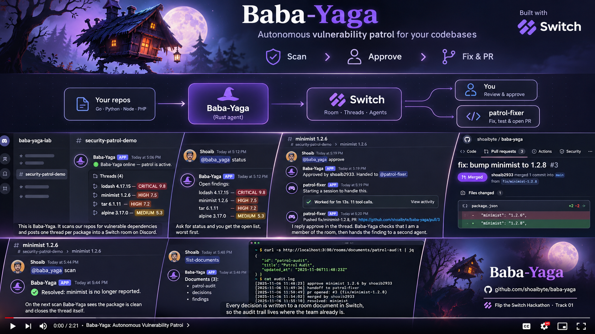
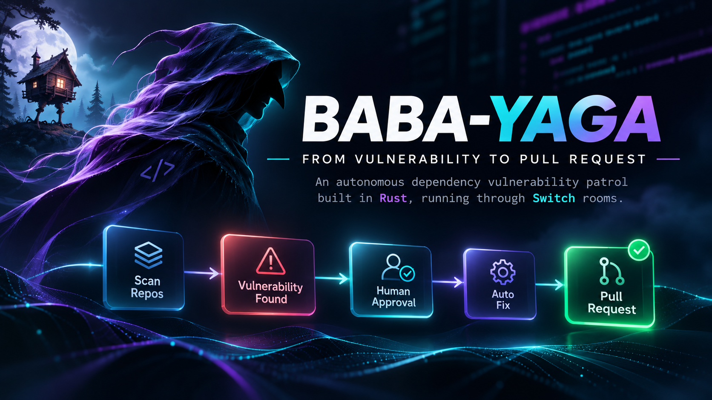
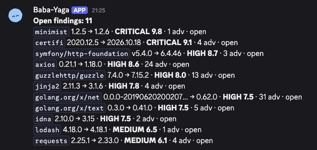
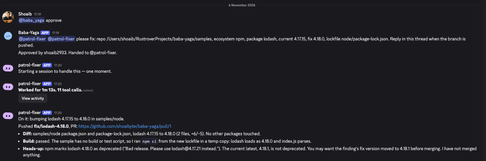
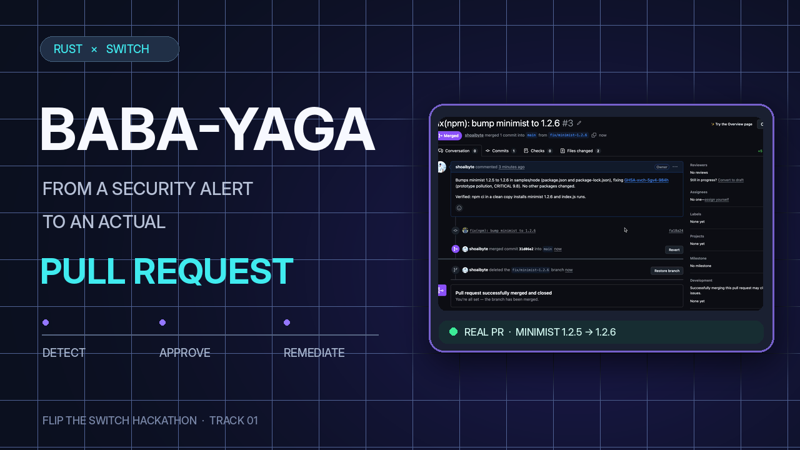
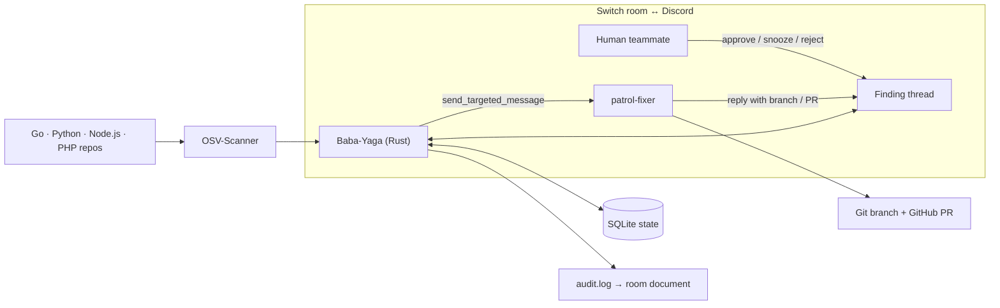
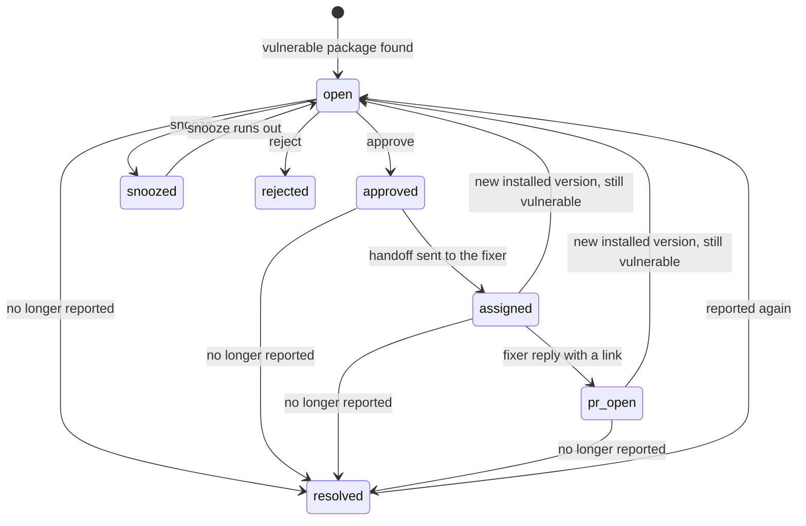

# Baba-Yaga

### Vulnerabilities enter the room. Fixes leave as pull requests.



*Illustration of the workflow. The screenshots further down are real captures.*

**A human-in-the-loop dependency security patrol built with Rust, [OSV-Scanner](https://google.github.io/osv-scanner/) and [Switch](https://docs.switchagents.ai/).**

[](https://www.rust-lang.org/)
[](https://docs.switchagents.ai/)
[](https://www.wemakedevs.org/hackathons/switch)
[](LICENSE)

> **The idea:** turn dependency vulnerability alerts into conversations a team can act on. People approve the fix in a Discord thread; a second agent prepares the pull request. No silent, autonomous dependency changes.

[](https://youtu.be/jJCuZW_2QxI)

Demo video: https://youtu.be/jJCuZW_2QxI (2 min 20 s, unlisted).

**Jump to:** [See it in action](#see-it-in-action) · [Try it](#-try-it-yourself) · [How Switch powers it](#why-switch-is-essential) · [Commands](#-talk-to-baba-yaga) · [Architecture](#under-the-hood) · [Troubleshooting](#-troubleshooting)

## Where to look

- [`crates/switch-client/src/ws.rs`](crates/switch-client/src/ws.rs): the Switch agent protocol client, written by hand: WebSocket, ping and pong with the cursor, resume.
- [`crates/baba-yaga/src/workflow.rs`](crates/baba-yaga/src/workflow.rs): the approval and handoff loop.
- [`template/patrol.template.yaml`](template/patrol.template.yaml): the room template that creates the room and the fixer.
- [`docs/NOTES.md`](docs/NOTES.md): everything we learned about Switch 0.31 that the docs do not say.

---

## Meet the patrol

A dependency scanner finds a vulnerable package. Normally that becomes another alert in a dashboard. With Baba-Yaga it becomes a thread your team can decide in.

| Who | Their job |
| --- | --- |
| **OSV-Scanner** | Finds vulnerable dependencies in Go, Python, Node.js and PHP repositories. |
| **Baba-Yaga** | Opens one Switch thread per affected package, tracks decisions and keeps an audit trail. |
| **You and your team** | Approve, reject or snooze findings from Discord. |
| **`patrol-fixer`** | Receives approved findings in the same thread, bumps the package on a branch and opens a PR. |

**The boundary:** Baba-Yaga does **not** approve fixes on its own, merge PRs or replace human code review.

## See it in action

The status reply in Discord:



One finding's thread, from the human approve to the fixer's PR reply:



The fixer's pull request, reviewed and merged by a human; the next scan closed the thread.



<details>
<summary><strong>Try the other choices</strong>: what if a fix can wait?</summary>

- `@baba_yaga snooze 30d`: hide a finding for 30 days; it reopens when the snooze runs out.
- `@baba_yaga reject`: close a finding as not needed; later scans skip it.
- `@baba_yaga status`: list the open findings with their status, then the rejected ones.

Use `approve`, `reject` and `snooze` **inside a finding's thread**. They are not channel commands.

</details>

### Your first mission

After setup:

- [ ] See **"Baba-Yaga online"** in the room.
- [ ] Send `@baba_yaga scan` and open a finding thread.
- [ ] Try `@baba_yaga status`.
- [ ] Approve **one test finding** and watch the handoff to `patrol-fixer`.
- [ ] Inspect the PR and the `baba-yaga-audit` room document.

> **Demo safely:** use the deliberately vulnerable `samples/` fixture or another throwaway repository. The sample dependencies are insecure on purpose and must never be deployed. The fixer may push a branch; check the destination and any permission prompt before allowing writes.

---

## 🚀 Try it yourself

**Recommended path:** Switch Console, Discord and the included room template. The steps below are the procedure that worked during development, not a one-command install.

**Platform:** macOS or Linux; the commands are written for a Unix-style shell.

### 0. Gather your gear

| Required | Why | Check |
| --- | --- | --- |
| [Rust stable and Cargo](https://rustup.rs/) | Build and run the Rust agent | `cargo --version` |
| [OSV-Scanner 2.x](https://google.github.io/osv-scanner/) | Scan manifests and lockfiles | `osv-scanner --version` |
| [Switch Console](https://docs.switchagents.ai/switch-rooms/getting-started/install-switch-console) **or** [self-hosted Switch](https://docs.switchagents.ai/switch-rooms/deploy/self-host) | Run the Switch server and manage rooms | The server answers `/health` |
| [Docker](https://docs.docker.com/get-docker/) | Only for self-hosted Switch or the bundled Mattermost; Console 0.40 runs the local server without Docker. | `docker --version` |
| A Discord server you can add a bot to | Bridge the team conversation to Switch | [Connection guide](https://docs.switchagents.ai/switch-rooms/deploy/messaging-apps/discord) |
| A Claude Code provider in Switch | Run the fixer agent | The agent can be created in Switch Console |
| GitHub access to the test repository | Let the fixer push a branch and open a PR | Repository permissions |
| Go, **optional** | Go reachability (call analysis); without it, Go findings are reported without reachability and a log line says so | `go version` |

Install OSV-Scanner with one of:

```bash
# macOS with Homebrew
brew install osv-scanner

# Or with Go (requires Go on PATH)
go install github.com/google/osv-scanner/v2/cmd/osv-scanner@latest
```

<details>
<summary><strong>Need Rust?</strong> Install the stable toolchain</summary>

Use the official rustup installer:

```bash
curl --proto '=https' --tlsv1.2 -sSf https://sh.rustup.rs | sh
```

Restart your shell if `cargo` is not found afterwards.

</details>

### 1. Start Switch and find its address

Start the local Switch server from Switch Console. Console runs it on a random local port, which changes when Console restarts. Find it from the server process:

```bash
ps eww -p $(pgrep -f switch_core.main) | tr ' ' '\n' | grep '^GATEWAY_PUBLIC_URL='
```

The address is the value of `GATEWAY_PUBLIC_URL`, for example `http://localhost:51970`. Set `SWITCH_URL` to it and check it:

```bash
export SWITCH_URL="http://localhost:51970"  # replace with your address
curl -s "$SWITCH_URL/health"
```

**Checkpoint:** the health endpoint answers. If not, check that the server is running and that you copied the current port.

> **Security tip:** process environments hold secrets. Never paste an unredacted process listing, registration key or admin password into an issue or a Discord channel.

### 2. Bridge Discord to Switch

Follow the [Connect Discord](https://docs.switchagents.ai/switch-rooms/deploy/messaging-apps/discord) guide. When Console asks to link your Discord user account, do it: that is what makes you the room owner (`sender_role: owner`) for the approval gate.

**Checkpoint:** Discord is connected to the server and your Discord account is linked.

### 3. Register Baba-Yaga, once

From the repository root:

```bash
cp .env.example .env
```

The registration key is the `AGENT_REGISTRATION_TOKEN` the server was started with. Read it from the server process:

```bash
ps eww -p $(pgrep -f switch_core.main) | tr ' ' '\n' | grep '^AGENT_REGISTRATION_TOKEN=' | cut -d= -f2-
```

Set these two in `.env`:

```dotenv
# The address from step 1
SWITCH_URL=http://localhost:51970
# The AGENT_REGISTRATION_TOKEN value above
SWITCH_REGISTRATION_KEY=
```

Then register the agent:

```bash
cargo run -p switch-client --example register
```

It prints `SWITCH_AGENT_ID=...` and `SWITCH_AGENT_KEY=...`. Copy both into `.env`. **The key is shown once.**

**Checkpoint:** `.env` has `SWITCH_URL`, `SWITCH_REGISTRATION_KEY`, `SWITCH_AGENT_ID` and `SWITCH_AGENT_KEY`.

> Run the register example once. A second run returns HTTP `409` because the name is taken. Never commit `.env`.

### 4. Let the room address Baba-Yaga

An API-registered agent is owned by "Agent Bootstrap", so Console cannot edit it. Open its addressing through the Gateway API; an empty rules list means anyone may address it. Baba-Yaga then applies its own approval check.

<details open>
<summary><strong>Gateway API commands</strong> (required for this setup)</summary>

With `.env` loaded (`set -a; . ./.env; set +a`):

```sh
# admin email/password are the GATEWAY_ADMIN_EMAIL / GATEWAY_ADMIN_PASSWORD the server was started with
# (Console: ps eww -p $(pgrep -f switch_core.main) | tr ' ' '\n' | grep '^GATEWAY_ADMIN_')
curl -s -c /tmp/gw.jar -X POST -H 'Content-Type: application/json' \
  -d '{"email":"<admin email>","password":"<admin password>"}' \
  "$SWITCH_URL/gateway/auth/login"
curl -s -b /tmp/gw.jar -X PUT -H 'Content-Type: application/json' \
  -d '{"policy":{"rules":[]}}' \
  "$SWITCH_URL/gateway/agents/$SWITCH_AGENT_ID/addressing-policy"
rm /tmp/gw.jar
```

Replace the placeholders locally. A password typed on the command line can end up in shell history, so avoid this on shared machines.

The empty rules list lets people address the agent; **it is not an authorization check on its own**. Baba-Yaga's code decides who may approve or reject. That check matches display names; see [Security and current limitations](#-security-and-current-limitations) before using a real repository.

**Checkpoint:** both requests succeed. Read the responses; a zero exit code from `curl` does not mean the request worked.

</details>

### 5. Create the room and the fixer

**With the template:**

1. In Switch Console, open **Templates**, select **Import template**.
2. Choose [`template/patrol.template.yaml`](template/patrol.template.yaml) and run it.
3. It creates the agent `patrol-fixer` and the room `patrol-security`, and posts a kickoff to the fixer.

The fixer must accept messages from **Anyone**: Baba-Yaga is not one of your own agents, so with "Me and my agents" the fixer would ignore the handoff. The template sets this.

<details>
<summary><strong>Prefer to create the room by hand?</strong></summary>

Create a room in Switch Console. Create a Claude Code agent named `patrol-fixer`, set Who can talk to your agent to Anyone, paste the instructions from the template's `instructions:` block, and add it to the room.

</details>

Then invite Baba-Yaga into the room. In the Discord channel (verified on Discord):

```text
/invite-agent agent:baba_yaga
```

**Name gotcha:** the agent registered as `baba-yaga`, but the server stores the name as `baba_yaga` and Discord addresses it that way; Console-created agents like `patrol-fixer` keep their hyphen.

Get the room id from the rooms Baba-Yaga is in:

```bash
set -a; . ./.env; set +a
curl -s -X POST -H "Authorization: Bearer $SWITCH_AGENT_KEY" -H 'Content-Type: application/json' -d '{}' "$SWITCH_URL/agents/$SWITCH_AGENT_ID/ops/list_rooms"
```

Put the room id in `.env` as `SWITCH_ROOM_ID`, or in the config below as `room`. If both are set, `SWITCH_ROOM_ID` wins.

**Checkpoint:** Baba-Yaga and `patrol-fixer` are in the same room, and `list_rooms` returns it.

### 6. Configure a safe demo scan

```bash
cp baba-yaga.example.toml baba-yaga.toml
```

Edit `baba-yaga.toml` (the fields are explained in [`baba-yaga.example.toml`](baba-yaga.example.toml)):

- `room`: the room id, unless you set `SWITCH_ROOM_ID`.
- `fixer_agent = "patrol-fixer"`.
- The repos to scan. For the bundled samples, use one `[[repos]]` entry with `url` set to the absolute path of `samples/`. Print it from the repository root with `(cd samples && pwd)`.

**Checkpoint:** the config points at the intended test directory and room. Review it before letting the fixer push anywhere.

### 7. Release the patrol

```bash
RUST_LOG=info cargo run -p baba-yaga -- serve
```

What you should see:

1. The log says `connected`.
2. The room gets **"Baba-Yaga online · watching 1 repo · next scan ..."**.
3. After the first scan, every vulnerable package has its own thread, titled `<package> <version> → <fix>`, with the advisory details as the first reply.
4. `@baba_yaga status` lists the findings.

To scan right away, mention Baba-Yaga in the room:

```text
@baba_yaga scan
```

Then open a finding's thread and send `@baba_yaga approve`. Baba-Yaga answers "Approved by <your Discord name>. Handed to patrol-fixer." and sends the fixer a targeted message in that thread. The first time the fixer pushes, Console may show a permission prompt for its `git push`; check the repository and allow it there.

**Victory condition:** a human approval leads to a fixer reply with a branch or PR link in **the same thread**. Once that reply contains a link (a URL or a `fix/` branch), `@baba_yaga status` lists the package as "PR open". A person still reviews the PR.

> Changes to `baba-yaga.toml` take effect when `serve` is restarted.

---

## 💬 Talk to Baba-Yaga

Address Baba-Yaga in the room. Approve, reject and snooze work only inside a finding's thread. After the mention, the message must be exactly one command from the table, in any case, with trailing punctuation allowed. Any other message in a thread gets no reply, so people can talk there without triggering anything.

| Command | Where | What it does |
|---|---|---|
| `@baba_yaga approve` | Finding thread | Room owner or room members only. Marks the finding approved and hands it to the fixer in the thread. |
| `@baba_yaga reject` | Finding thread | Room owner or room members only. Closes the finding as not needed; later scans skip it. |
| `@baba_yaga snooze 30d` | Finding thread | Hides the finding for a number of days (`d`) or weeks (`w`), up to 365 days. It reopens when the snooze runs out. |
| `@baba_yaga status` | Anywhere | Lists open findings with their status, then rejected ones. |
| `@baba_yaga scan [repo]` | Anywhere | Scans now, all repos or the one named, and posts the result. |
| `@baba_yaga help` | Anywhere | Lists the commands. |

**Tip:** a command in the channel is not the same as a command in a finding's thread. Approve, snooze and reject act on the finding whose thread they are sent in.

## Why Switch is essential

Switch is not a notification layer here. It is the shared workspace and protocol the human and agent workflow runs on.

| Switch capability | What Baba-Yaga does with it |
| --- | --- |
| **Custom agent protocol** | Registers with `POST /agents` and runs its own Rust WebSocket client: every ping is answered with a pong that carries its cursor, and it resumes from that cursor after a drop or an eviction. |
| **Rooms and threads** | Keeps each finding, its decision and the fixer's reply in one thread. |
| **Targeted agent messages** | On approve, calls `send_targeted_message` with the fixer as the target and the thread id, so the handoff lands in the finding's thread and addresses only the fixer. |
| **Room documents** | Mirrors the local `audit.log` to the room document `baba-yaga-audit`, readable by everyone in the room. |
| **Addressing policy** | Opened so room members can address Baba-Yaga at all; Baba-Yaga's own check then lets only the room owner or a room participant approve or reject. |
| **Templates** | `template/patrol.template.yaml` creates the room and the fixer in one run. |

Without Switch, there would be no shared room where people and both agents see the same thread. Approvals would have no place to happen, the fixer would have no way to receive a handoff addressed to it, and the audit document would have no readers. What would remain is a scanner that prints JSON.

---

## Under the hood



**Scanning:** osv-scanner runs over each configured repository. For Go, call analysis marks findings whose vulnerable code is actually called; it needs `go` on `PATH` and `call_analysis = true` (the default). Other ecosystems are reported without reachability.

**State:** Baba-Yaga keeps one SQLite row per package: its thread, its status and the PR link. Every decision is also appended to `audit.log`, which is mirrored to the `baba-yaga-audit` room document.

<details>
<summary><strong>Follow the state machine</strong></summary>



The diagram shows the main path. Snooze and reject are also accepted on a finding that is already approved or with the fixer. If the handoff fails, the finding stays `approved` and the thread says why.

`resolved` means **the scanner no longer reports the package**, not that Baba-Yaga checked or merged a PR. If a later scan reports it again, it returns to `open` in its old thread, with a "Reappeared" reply, ready to be approved again.

</details>

<details>
<summary><strong>For engineers: the interesting source files</strong></summary>

| File | Start here to understand |
| --- | --- |
| [`crates/switch-client/src/ws.rs`](crates/switch-client/src/ws.rs) | The hand-written WebSocket client: ping and pong with the cursor, reconnect and resume. |
| [`crates/baba-yaga/src/workflow.rs`](crates/baba-yaga/src/workflow.rs) | Serve, report and the scan, decision and fixer handoff loop. |
| [`crates/baba-yaga/src/state.rs`](crates/baba-yaga/src/state.rs) | Package state in SQLite. |
| [`crates/baba-yaga/src/audit.rs`](crates/baba-yaga/src/audit.rs) | The audit log and its room document mirror. |
| [`template/patrol.template.yaml`](template/patrol.template.yaml) | How the room and the fixer agent are created. |
| [`docs/WS_DESIGN.md`](docs/WS_DESIGN.md) | The WebSocket client design: cursor, reconnect, eviction. |
| [`docs/NOTES.md`](docs/NOTES.md) | Observed Switch 0.31 behaviour that the public docs do not cover. |
| [`docs/PROGRESS.md`](docs/PROGRESS.md) | Build log by stage, with live test results. |

The workspace also has `crates/switch-client/examples/` (`register`, `echo`, `post_message`, `ops_probe`, `ws_probe`), and `crates/baba-yaga/src/scanner/` and `crates/baba-yaga/src/room/` for scanning, command parsing and message text.

</details>

## Samples and one-shot scanning

[`samples/`](samples/) pins known-vulnerable dependency versions on purpose, as fixed input for demos and tests. **Never deploy them** or use them as a starting point for real code.

| Fixture | Pinned dependencies |
| --- | --- |
| `samples/go/` | `golang.org/x/text`, `golang.org/x/net` |
| `samples/python/` | `requests`, `urllib3`, `jinja2` |
| `samples/node/` | `lodash`, `minimist`, `axios` |
| `samples/php/` | `symfony/http-foundation`, `guzzlehttp/guzzle` |

**PHP note:** `samples/php/composer.lock` is hand-written and lists only the two pinned packages, so the demo needs no PHP toolchain. osv-scanner reads it, but `composer install` will not work.

For a single run instead of a patrol, `report` scans once, posts each package with findings as a thread, and exits:

```bash
cargo run -p baba-yaga -- report --dry-run          # print the posts, send nothing
cargo run -p baba-yaga -- report --path samples     # scan a directory instead of the configured repos
```

`report` opens a socket while it posts, because thread replies need one, so **stop `serve` first**: the agent holds one connection at a time. `action/action.yml` is a **placeholder** GitHub Action for this mode. It is not yet wired to a public runner, and a CI runner would also need network access to the Switch server.

---

## 🧯 Troubleshooting

| Symptom | Likely cause | What to check |
| --- | --- | --- |
| `/health` does not answer | Switch is not running, or Console changed its port | Find `GATEWAY_PUBLIC_URL` again (step 1) and update `SWITCH_URL` in `.env`. |
| Registration returns `409` | The name is already registered | Registration is one-time; reuse the saved `SWITCH_AGENT_ID` and `SWITCH_AGENT_KEY`. |
| Baba-Yaga is in the room but never answers | Its addressing policy is not open, or it was not invited | Step 4, then step 5's `/invite-agent`. |
| A message in a thread gets no reply | It is not exactly one command | Send only the mention and the command, for example `@baba_yaga approve`. |
| "Reply inside a finding's thread to approve, reject or snooze it." | The command was sent in the channel | Send it inside the finding's thread. |
| "Only a room member can approve or reject." | You are neither the room owner nor a room participant | Link your Discord account (step 2), or join the room as a participant. |
| "... but the handoff to patrol-fixer failed ..." | The fixer is not in the room, or `fixer_agent` does not match its name | Add `patrol-fixer` to the room and check `fixer_agent`; the finding stays approved, so approve again. |
| The fixer ignores the handoff | The fixer's addressing is too narrow | Set `patrol-fixer` to **Anyone**, as the template does. |
| Go findings have no reachability | `go` is not on `PATH`, or `call_analysis = false` | The log says which: "Go call analysis: skipped" or "disabled in config". |
| No PR appears | The fixer lacks permissions or has not finished | Read the fixer's replies in the thread, its GitHub access and any `git push` permission prompt in Console. |
| Config changes are ignored | `serve` reads `baba-yaga.toml` at start | Restart `serve`. |
| `report` cannot connect while `serve` runs | The agent holds one connection at a time | Stop `serve` before running `report`. |

For Switch itself, see [Switch troubleshooting](https://docs.switchagents.ai/switch-rooms/resources/troubleshooting) and [`docs/NOTES.md`](docs/NOTES.md).

## 🔐 Security and current limitations

Baba-Yaga is a hackathon prototype, **not a production-ready authorization system**.

- **Display-name matching:** room members are matched by display name (`sender_name`), the only identifier the message event and the participant list share. A user who can change their display name to a member's could pass the approval check. Use a trusted demo room and repository.
- **No reviewer agent yet:** a person reviews the fixer's pull request, and Baba-Yaga does not move a finding beyond `pr_open`.
- **Deprecated fix versions:** the fix version is the highest fixed version the advisories list, and the registry may have deprecated it. The handoff lists the other fixed versions and asks the fixer to avoid a deprecated one, but Baba-Yaga does not check the registry itself.
- **Go-only reachability:** reachability is analysed for Go only. Findings in other ecosystems are reported without it.
- **Lockfiles, not runtimes:** vulnerabilities in the PHP interpreter itself, such as PHP2Shell, are out of scope: Baba-Yaga reads lockfiles, and a lockfile does not name the interpreter version.
- **UTC:** schedules and times are in UTC.
- **Port changes:** Switch Console picks a random local port each time it restarts, so `SWITCH_URL` in `.env` must be updated after a restart.
- **Sensitive files:** keep `.env`, registration keys and admin credentials private. The `baba-yaga-audit` room document is readable by everyone in the room.

## Development

Checks, run before every commit:

```bash
cargo fmt --all
cargo clippy --all-targets -- -D warnings
cargo test
```

| Directory | Purpose |
| --- | --- |
| `crates/switch-client` | The Switch agent protocol client: HTTP, WebSocket with ping, pong and resume, operations, typed events, and examples. |
| `crates/baba-yaga` | The patrol: scanner, SQLite state, room commands and message text, workflow, audit log. |
| `template/` | The Switch room template. |
| `samples/` | Deliberately vulnerable sample projects. |
| `action/` | The CI placeholder. |
| `docs/` | Switch notes, WebSocket design, build log, README images. |

## What's next

Possible next steps, **not implemented**: stable user identity for approvals, a PR-review agent, narrower permissions for the fixer, easier onboarding and a working CI action.

---

### Built for the [Flip the Switch hackathon](https://www.wemakedevs.org/hackathons/switch) · Best Business Workflow

**The point is not another scanner. It is a workflow where people decide and agents do the tedious part, together, in the same room.**

MIT licensed. See [`LICENSE`](LICENSE).
